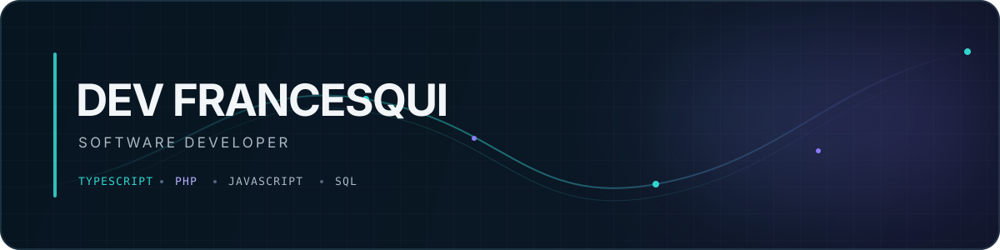

  

# Dev Francesqui

**Desenvolvimento de software · Aplicações web · APIs**

## Sobre

Desenvolvedor de software com experiência prática em sistemas web, APIs e evolução de aplicações em produção. Trabalho em projetos novos e sistemas existentes, buscando entregar soluções úteis, bem integradas e sustentáveis.

## Tecnologias

Linguagens identificadas nos projetos e alterações que venho realizando:

**Stack e ferramentas:** React · NestJS · Node.js · PostgreSQL · MariaDB · TypeORM · Docker · GitHub Actions

## Projetos em destaque

### NexFlow

ERP web para gestão de negócios, com módulos financeiros, fiscais e operacionais. Trabalho envolvendo frontend React, APIs NestJS e persistência em PostgreSQL.

**Tecnologias:** TypeScript, React, NestJS, PostgreSQL, TypeORM, Docker

### Siscredit

Sistema de negócio em evolução, com manutenção e novas funcionalidades em módulos existentes, incluindo áreas do cliente e rotinas de ponto.

**Tecnologias:** PHP, JavaScript, SQL, MariaDB

### Creditall Services

Serviços e APIs que dão suporte aos sistemas da Creditall, incluindo funcionalidades compartilhadas com o Siscredit.

**Tecnologias:** TypeScript, Node.js, NestJS, SQL

## Atividade no GitHub

  <picture>
    <source media="(prefers-color-scheme: dark)" srcset="https://raw.githubusercontent.com/Victor-Francesqui/Victor-Francesqui/output/github-snake-dark.svg" />
    <source media="(prefers-color-scheme: light)" srcset="https://raw.githubusercontent.com/Victor-Francesqui/Victor-Francesqui/output/github-snake.svg" />
    
  </picture>

*Construindo, aprendendo e melhorando um commit de cada vez.*

---

📍 Brasil · Aberto a conexões e colaborações em desenvolvimento de software

