<div align="center">

<picture>
  <source media="(prefers-color-scheme: dark)" srcset="./assets/profile-banner-dark.svg">
  <source media="(prefers-color-scheme: light)" srcset="./assets/profile-banner-light.svg">
  
</picture>

<br/>

<a href="https://github.com/Victor-Francesqui">
  
</a>

<br/>


<br/><br/>

<code><a href="#-sobre">./sobre</a></code> &nbsp;
<code><a href="#-competências">./competências</a></code> &nbsp;
<code><a href="#-stack">./stack</a></code> &nbsp;
<code><a href="#-projetos">./projetos</a></code> &nbsp;
<code><a href="#-atividade">./atividade</a></code> &nbsp;
<code><a href="#-contato">./contato</a></code>

</div>

<br/>

## `$` sobre

```ts
const victor = {
  role: "Desenvolvedor de software",
  focus: ["sistemas empresariais", "APIs", "modernização de aplicações"],
  linguagens: ["TypeScript", "PHP", "JavaScript", "SQL"],
  abordagem: "entender o problema → evoluir a solução → validar o resultado",
};
```

> Gosto de transformar necessidades reais da operação em software claro, útil e sustentável.

<br/>

## `$` competências

<table>
<tr>
<td width="33%" valign="top">

**`01` · Aplicações**

```diff
+ Interfaces web com React
+ APIs e serviços com NestJS
+ Integrações entre sistemas
+ Evolução de funcionalidades
```

</td>
<td width="33%" valign="top">

**`02` · Dados**

```diff
+ Consultas e modelagem SQL
+ PostgreSQL e MariaDB
+ Persistência com TypeORM
+ Integração com dados existentes
```

</td>
<td width="33%" valign="top">

**`03` · Sistemas**

```diff
+ ERPs e aplicações empresariais
+ Manutenção de sistemas legados
+ Modernização incremental
+ Fluxos de negócio e regras
```

</td>
</tr>
</table>

<br/>

## `$` stack

<div align="center">


<br/>

<br/>


</div>

<details>
<summary><code>cat stack.yml</code></summary>

<br/>

```yaml
linguagens:     [TypeScript, PHP, JavaScript, SQL]
frontend:       [React, Vite, Tailwind CSS]
backend:        [Node.js, NestJS, TypeORM]
dados:          [PostgreSQL, MariaDB]
ferramentas:    [Docker, Git, GitHub Actions]
```

</details>

<br/>

## `$` projetos

### NexFlow

ERP web para gestão de negócios, com foco em varejo óptico. Trabalho em módulos e integrações de uma aplicação com frontend React, APIs NestJS e PostgreSQL.

<sub><code>TypeScript</code> · <code>React</code> · <code>NestJS</code> · <code>PostgreSQL</code> · <code>TypeORM</code></sub>

### Siscredit

Sistema empresarial em evolução, com trabalho em módulos existentes, área do cliente e funcionalidades de ponto.

<sub><code>PHP</code> · <code>JavaScript</code> · <code>SQL</code> · <code>MariaDB</code></sub>

### Creditall Services

Serviços e APIs do ecossistema Creditall, incluindo funcionalidades integradas ao Siscredit.

<sub><code>TypeScript</code> · <code>Node.js</code> · <code>NestJS</code> · <code>SQL</code></sub>

<br/>

## `$` atividade

<div align="center">

<a href="https://github.com/Victor-Francesqui">
  
</a>
<a href="https://github.com/Victor-Francesqui">
  
</a>

<br/>

<a href="https://github.com/Victor-Francesqui">
  
</a>

<br/><br/>

<picture>
  <source media="(prefers-color-scheme: dark)" srcset="https://raw.githubusercontent.com/Victor-Francesqui/Victor-Francesqui/output/github-snake-dark.svg">
  <source media="(prefers-color-scheme: light)" srcset="https://raw.githubusercontent.com/Victor-Francesqui/Victor-Francesqui/output/github-snake.svg">
  
</picture>

</div>

<br/>

## `$` contato

<div align="center">

<a href="https://github.com/Victor-Francesqui">
  
</a>

<br/><br/>

```console
$ echo $MOTTO
Entender o problema. Construir a solução. Melhorar continuamente.
```

</div>

