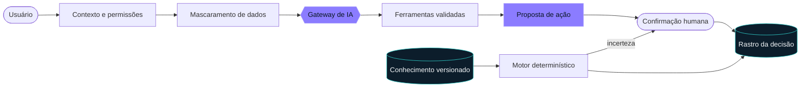

<div align="center">

<picture>
  <source media="(prefers-color-scheme: dark)" srcset="./assets/profile-banner-dark.svg">
  <source media="(prefers-color-scheme: light)" srcset="./assets/profile-banner-light.svg">
  
</picture>

<br/>

<a href="https://github.com/Victor-Francesqui">
  
</a>

<br/>


<br/><br/>

<code><a href="#-sobre">./sobre</a></code> &nbsp;
<code><a href="#-competências">./competências</a></code> &nbsp;
<code><a href="#-stack">./stack</a></code> &nbsp;
<code><a href="#-projetos">./projetos</a></code> &nbsp;
<code><a href="#-ia-aplicada">./ia</a></code> &nbsp;
<code><a href="#-atividade">./atividade</a></code> &nbsp;
<code><a href="#-contato">./contato</a></code>

</div>

<br/>

## `$` sobre

```ts
const victor = {
  role:       "Desenvolvedor de software",
  focus:      ["sistemas empresariais", "APIs", "modernização de aplicações"],
  linguagens: ["TypeScript", "PHP", "JavaScript", "SQL"],
  abordagem:  "entender o problema → evoluir a solução → validar o resultado",
};
```

> Gosto de transformar necessidades reais da operação em software claro, útil e sustentável.

<br/>

## `$` competências

<table>
<tr>
<td width="33%" valign="top">

**`01` · Aplicações**

```diff
+ Interfaces em React
+ APIs com NestJS
+ Integração de sistemas
+ Novas funcionalidades
```

</td>
<td width="33%" valign="top">

**`02` · Dados**

```diff
+ Modelagem e SQL
+ PostgreSQL e MariaDB
+ Persistência TypeORM
+ Dados já existentes
```

</td>
<td width="33%" valign="top">

**`03` · Sistemas**

```diff
+ ERPs empresariais
+ Sistemas legados
+ Modernização gradual
+ Regras de negócio
```

</td>
</tr>
</table>

<br/>

## `$` stack

<div align="center">


<br/>

<br/>


<br/>


</div>

<details>
<summary><code>cat stack.yml</code></summary>

<br/>

```yaml
linguagens:     [TypeScript, JavaScript, PHP, SQL]
frontend:       [React, Next.js, Vite, Tailwind CSS]
backend:        [Node.js, NestJS, TypeORM, Prisma]
dados:          [PostgreSQL, MariaDB]
web:            [HTML, CSS, JSX/TSX, Vue SFC]
scripts:        [Python, Go, Bash]
configuracao:   [JSON, YAML]
schemas:        [XML, XSD, SQL]
contato-legado: [Java/JSP, Ruby em componentes integrados]
ferramentas:    [Docker, Linux, Git, GitHub Actions]
```

</details>

<br/>

## `$` projetos

<table>
<tr>
<td width="50%" valign="top">

**`nexflow`** · ERP web

ERP para gestão de negócios, com foco em varejo óptico. Trabalho em módulos e integrações.

<sub><code>TypeScript</code> <code>React</code> <code>NestJS</code> <code>PostgreSQL</code> <code>TypeORM</code></sub>

</td>
<td width="50%" valign="top">

**`siscredit`** · sistema empresarial

Evolução de módulos existentes, área do cliente e funcionalidades de ponto.

<sub><code>PHP</code> <code>JavaScript</code> <code>SQL</code> <code>MariaDB</code></sub>

</td>
</tr>
<tr>
<td width="50%" valign="top">

**`creditall-services`** · serviços e APIs

Serviços do ecossistema Creditall, incluindo funcionalidades integradas ao Siscredit.

<sub><code>TypeScript</code> <code>Node.js</code> <code>NestJS</code> <code>SQL</code></sub>

</td>
<td width="50%" valign="top">

**`wulfy-erp`** · SaaS em construção

ERP e plataforma SaaS, com frontend e backend em TypeScript e banco PostgreSQL.

<sub><code>TypeScript</code> <code>Next.js</code> <code>NestJS</code> <code>Prisma</code> <code>PostgreSQL</code></sub>

</td>
</tr>
</table>

<br/>

## `$` IA aplicada

<div align="center">


<sub><code>agents.office</code> — cada agente representa uma etapa real dos fluxos que construo</sub>

</div>

<br/>

IA em dois lugares: **no desenvolvimento**, para preparar contexto antes de cada alteração, e **no produto**, com permissões, regras versionadas e revisão humana.

```bash
$ ia --fluxos
  ├── graphify      mapa local do código, extraído da estrutura e sem chamar LLM
  ├── contexto      query, path e explain para localizar dependências
  ├── gateway       Anthropic, provedores compatíveis com OpenAI ou IA desligada
  ├── privacidade   dados pessoais mascarados antes da chamada
  ├── ferramentas   consultas e ferramentas validadas
  ├── regras        conhecimento estruturado e motor determinístico
  └── rastro        entradas, versões das regras, participação da IA e resultado
```

<details open>
<summary><code>cat fluxo-nexflow.mmd</code></summary>

<br/>



</details>

> [!IMPORTANT]
> No NexFlow, a IA propõe e a pessoa confirma. Regras determinísticas e o rastro de cada decisão ficam fora do modelo.

<br/>

## `$` atividade

<div align="center">

<picture>
  <source media="(prefers-color-scheme: dark)" srcset="https://raw.githubusercontent.com/Victor-Francesqui/Victor-Francesqui/output/activity-dark.svg">
  <source media="(prefers-color-scheme: light)" srcset="https://raw.githubusercontent.com/Victor-Francesqui/Victor-Francesqui/output/activity-light.svg">
  
</picture>

<br/><br/>

<picture>
  <source media="(prefers-color-scheme: dark)" srcset="https://raw.githubusercontent.com/Victor-Francesqui/Victor-Francesqui/output/github-snake-dark.svg">
  <source media="(prefers-color-scheme: light)" srcset="https://raw.githubusercontent.com/Victor-Francesqui/Victor-Francesqui/output/github-snake.svg">
  
</picture>

</div>

<br/>

## `$` contato

<div align="center">

<a href="https://github.com/Victor-Francesqui">
  
</a>

<br/><br/>

```console
$ echo $MOTTO
Entender o problema. Construir a solução. Melhorar continuamente.
```


</div>
