<picture>
  <source media="(prefers-color-scheme: dark)" srcset="./assets/profile-banner-dark.svg">
  <source media="(prefers-color-scheme: light)" srcset="./assets/profile-banner-dark.svg">
  
</picture>

 

 

  

 &nbsp;
 &nbsp;
 &nbsp;
 &nbsp;
 &nbsp;
 &nbsp;

 

## `$` sobre

 

## `$` competências

 

## `$` stack

 

 

 

 

## `$` projetos

 

## `$` IA aplicada

  

  

 

## `$` atividade

  

 

## `$` contato

 

 

